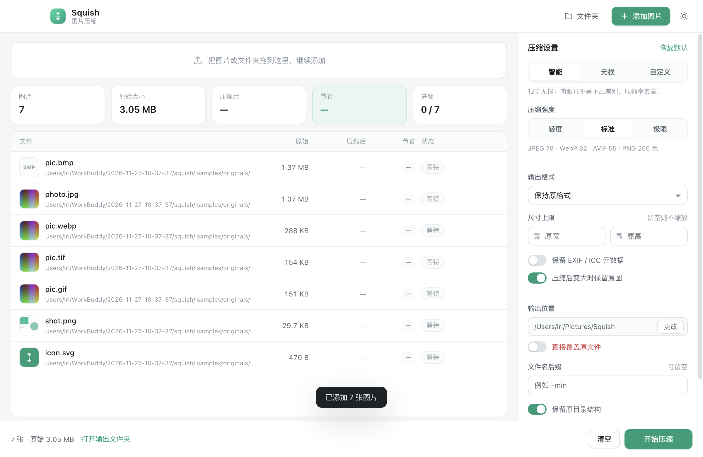
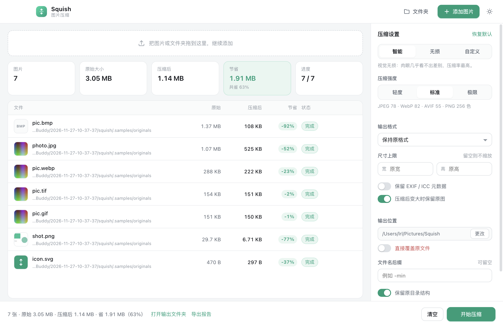
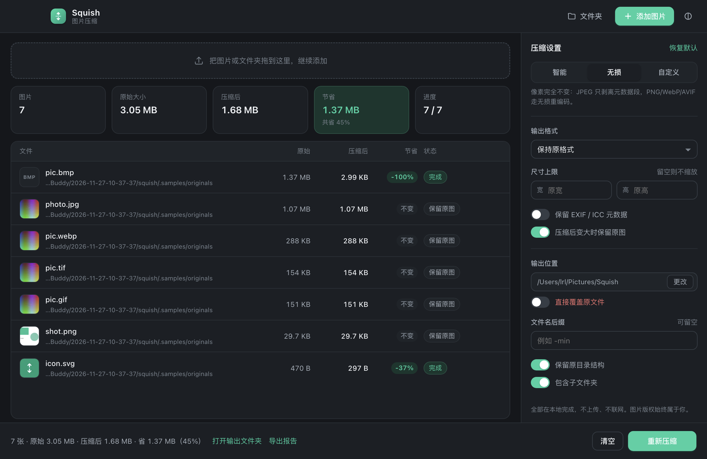

# Squish

[](https://github.com/isopbot/squish/releases/latest)

[](LICENSE)

**本地批量图片压缩工具 · macOS / Windows** — 选图片或整个文件夹，一次压完，全程不上传。

> 类似 TinyPNG，但所有处理都在你自己的电脑上完成：没有上传、没有张数限制、没有水印、断网也能用。

## 下载

到 [Releases](https://github.com/isopbot/squish/releases/latest) 下载对应安装包：

| 平台 | 文件 |
|---|---|
| macOS（Apple Silicon / M 系列） | `Squish-1.0.0-arm64.dmg` |
| macOS（Intel） | `Squish-1.0.0-x64.dmg` |
| Windows（安装版） | `Squish-Setup-1.0.0.exe` |
| Windows（免安装） | `Squish-1.0.0-portable.exe` |

安装包未做代码签名：macOS 首次打开请右键 →「打开」；Windows 遇 SmartScreen 点「更多信息 → 仍要运行」。



## 特性

- **两种导入方式**：拖拽 / 多选图片，或直接选一个文件夹（可选是否递归子目录），自动跳过 `.git`、`node_modules`、隐藏目录等噪音
- **三种压缩强度**：无损 / 智能（三档预设）/ 自定义质量，可按目标格式分别调参
- **八种格式**：JPG、PNG、WebP、AVIF、GIF、TIFF、BMP、SVG；支持输出格式转换（JPEG / PNG / WebP / AVIF）
- **尺寸上限**：超过设定长边的图自动等比缩小（可选，默认关闭）
- **绝不越压越大**：输出体积 ≥ 原图时自动保留原图（可关）
- **输出控制**：覆盖原文件 / 输出到指定目录 / 保留原目录结构 / 自定义后缀
- **看得见的收益**：逐行前后体积对比、节省率、总节省统计、可导出 CSV 报告、随时取消
- **细节**：EXIF 方向自动校正、缩略图列表、深色模式、设置持久化

## 截图

| 压缩完成（浅色） | 深色模式 |
|---|---|
|  |  |

## 无损是真无损吗？

不是所有格式都能"重编码还无损"，所以 Squish 按格式分策略处理：

| 格式 | 无损模式的做法 | 是否像素级无损 |
|---|---|---|
| JPEG | **字节级剥离 APPn / COM 元数据段**（等价 `jpegtran -copy none`），熵编码数据一个字节都不动 | ✅ |
| PNG | zlib 最高压缩档 + 自适应滤波重编码 | ✅ |
| WebP | VP8L 无损重编码 | ✅ |
| AVIF | AV1 lossless 重编码 | ✅ |
| TIFF | Deflate 无损重编码 | ✅ |
| SVG | svgo 多轮瘦身（矢量无损） | ✅ |
| WebP / AVIF / GIF 源图 | 直接跳过并说明原因 —— 它们已是有损编码，重编码只会变大 | — |

两个保护细节：

1. JPEG 若 `EXIF Orientation ≠ 1`，会保留这段 EXIF，否则图片会被转歪；
2. 所有模式默认「压缩后更大就保留原图」。

## 实测数据（2400×1600 样本）

```
photo.jpg  1093 KB → 525 KB   省 52%     智能·标准
shot.png     30 KB → 6.7 KB   省 77%     PNG 量化
pic.bmp    1406 KB → 108 KB   省 92%     BMP → PNG
icon.svg    0.5 KB → 0.3 KB   省 37%     svgo
合计       3.05 MB → 1.14 MB  省 63%
```

## 开发

需要 Node.js 18+。

```bash
npm install
npm start          # 启动应用
npm run test:engine # 跑压缩引擎自检（自动生成样本，校验压缩率与无损真实性）
```

首次安装如果 Electron 二进制下载慢，可加镜像：

```bash
ELECTRON_MIRROR="https://cdn.npmmirror.com/binaries/electron/" npm install
```

## 打包

```bash
npm run dist:mac        # macOS: arm64 + x64 两个 dmg
npm run dist:mac:arm64  # 只打 Apple Silicon
npm run dist:mac:x64    # 只打 Intel
npm run dist:win        # Windows: nsis 安装版 + portable 免安装版
```

产物在 `release/`。安装包**未做代码签名**：macOS 首次打开需右键 →「打开」，Windows 会弹 SmartScreen，点「更多信息 → 仍要运行」。

### 跨架构打包要注意 sharp 原生库

sharp 的原生依赖（`@img/sharp-<平台>-<架构>` + libvips）只会装当前机器那一份。交叉打包时必须换掉，否则打出来的包在目标机器上一启动就崩——典型症状是 Intel dmg 里塞着 arm64 的 `.node`，或者 mac 包里带着 Windows 版 libvips。

打包脚本已用 `scripts/native-deps.js` 处理：

```bash
node scripts/native-deps.js ensure darwin x64   # 缺什么补什么（npm pack 绕过平台校验）
node scripts/native-deps.js prune  darwin x64   # 删掉其它平台的 @img 目录
node scripts/native-deps.js status              # 看看当前装了哪些
```

`dist:mac:arm64` / `dist:mac:x64` / `dist:win` 都是「ensure → prune → electron-builder」三步。跑完 `dist:mac` 会自动 `restore:dev` 把本机（darwin-arm64）的依赖装回来；跑过 `dist:win` 之后请手动执行一次 `npm run restore:dev`，否则本机 `npm start` 会因为只剩 Windows 版 sharp 而起不来。

## 自动发版（GitHub Actions）

`.github/workflows/release.yml`：推 tag 即自动出包并挂到 Release。

```bash
git tag v1.0.1 && git push origin v1.0.1
```

流程：`npm run test:engine` 自测（无损被破坏或压缩后变大则中止）→ 三台 runner 并行打包（mac arm64 / mac x64 / win x64）→ 汇总上传 Release。也可以在 Actions 页面手动 `Run workflow` 触发构建（不会发版）。

## 目录结构

```
src/
├── main/
│   ├── index.js          # 主进程：窗口、对话框、任务队列、IPC
│   ├── compressor.js     # 压缩引擎：格式/质量/尺寸/元数据策略
│   ├── formats.js        # 扩展名 ↔ 格式映射
│   ├── jpeglossless.js   # JPEG 字节级元数据剥离
│   ├── bmp.js            # BMP 解码（sharp 不支持读 BMP）
│   └── scanner.js        # 目录递归扫描与过滤
├── preload/index.js      # contextBridge 暴露的受限 API
└── renderer/             # 界面（原生 HTML/CSS/JS，无框架）
scripts/                  # 引擎自测、图标生成、sharp 原生依赖 ensure/prune
.github/workflows/        # 推 tag 自动打包发版
```

技术栈：Electron + sharp(libvips) + svgo，界面无框架、无打包步骤，改完样式刷新即可。

## 已知限制

- **HEIC 暂不支持**：受 HEVC 授权限制，libheif 编译时未带解码器。iPhone 照片需先导出为 JPEG。
- **未签名**：见上文打包说明。
- macOS 上首次使用文件夹递归扫描时，系统可能询问磁盘访问权限。

## Roadmap

- [ ] HEIC 解码（macOS 走 `sips` 兜底转码）
- [ ] 压缩前后对比预览
- [ ] 批量任务队列 / 命令行模式
- [ ] 拖入文件夹时按子目录分组导出

## License

[MIT](LICENSE)
